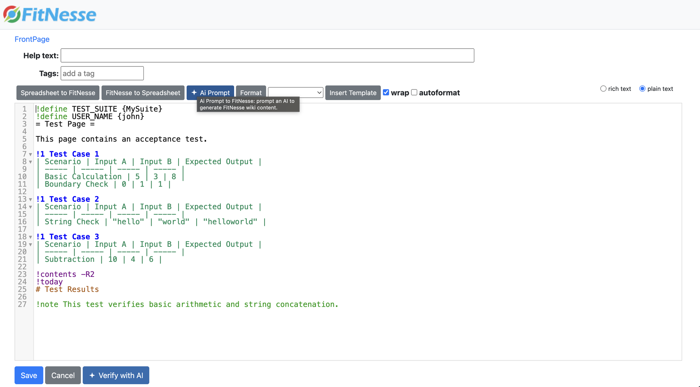
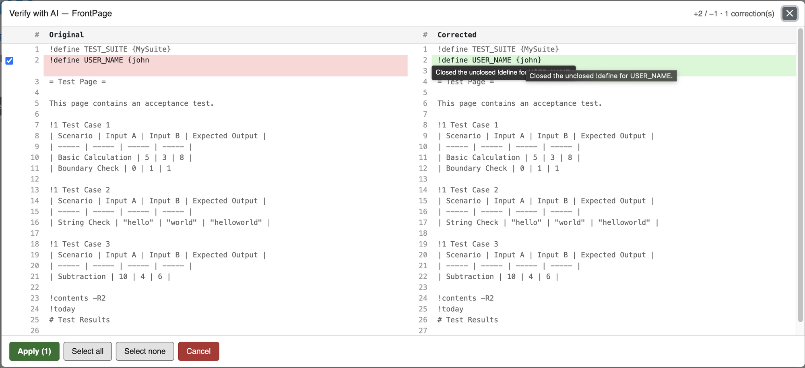
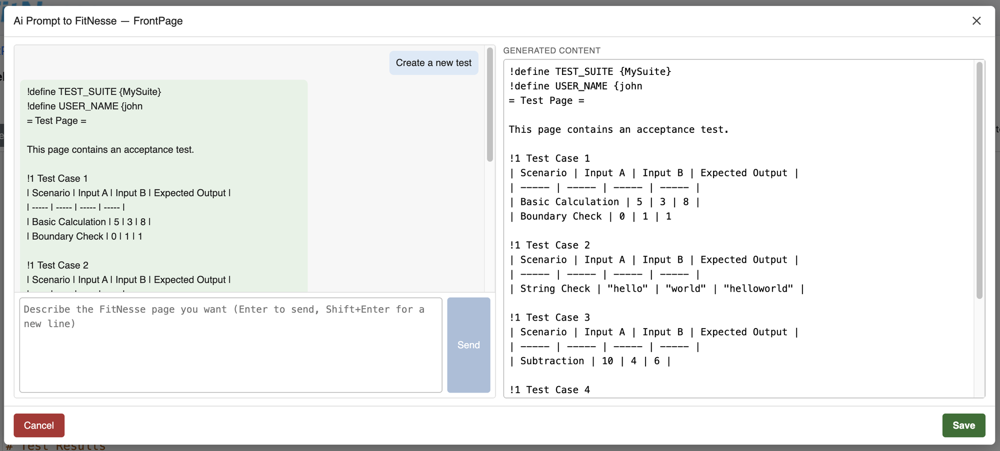

# FitNesse AI Plugin

[](https://central.sonatype.com/artifact/io.github.tortaje/fitnesse-ai)
[](LICENSE)

AI-assisted editing for the [FitNesse](https://fitnesse.org) wiki. The plugin adds two
buttons to the page editor, backed by any **OpenAI-compatible LLM** (OpenAI, Ollama,
LM Studio, vLLM, Azure/OpenRouter gateways...):

- **Verify with AI** proofreads the page and shows the proposed corrections in a
  selectable side-by-side diff.
- **Ai Prompt** generates or refines FitNesse wiki text from a plain-language request.

Nothing is ever saved automatically: both features only change the editor content, and
you still press **Save** yourself.



## Features

### Verify with AI

- Button next to **Save** on the edit (`?edit`) and new-page (`?new`) forms, for static
  pages, tests and suites.
- Analyses the current textarea content, **including unsaved changes**.
- Side-by-side diff of the complete texts with line numbers: unchanged lines in gray,
  original in red, corrected in green.
- One checkbox per correction block (all checked by default); hover a corrected line to
  read the LLM's explanation.
- **Apply (n)** merges the selected corrections into the editor. It is refused if the
  text changed since the verification (re-run it).



### Ai Prompt to FitNesse

- Toolbar button between *FitNesse to Spreadsheet* and *Format* (plain-text mode).
- Two-panel modal: describe the page you want on the left, the generated wiki text
  appears on the right.
- The right panel is editable and re-sent with every **Send**, so the LLM refines your
  hand edits instead of starting over.
- The page type (static, test, suite) and name are passed to the LLM so it produces the
  right kind of page.
- **Save** closes the modal and replaces the whole editor content.



### Common

- Works with any chat-completions endpoint (`POST {base.url}/chat/completions`).
- Customisable system prompts, inline or from a file re-read on every request (no
  restart needed).
- Optional debug logging of the full LLM exchange.
- No registration needed: the plugin discovers itself through `ServiceLoader`.

## How it works

```
 Browser (edit form)                     FitNesse + plugin                    LLM
 ───────────────────                     ─────────────────                    ───
 ?edit / ?new  ───────────────────────►  AiVerifyEditResponder /
                                         AiVerifyNewPageResponder
               ◄── page + ai-verify.js ─ (AssetInjector adds the JS and CSS)
               ◄──    ai-verify.css

 Verify click ── POST responder=ai-verify ─►  AiVerifyResponder
                                              └─ LlmClient ── chat/completions ─►
                                              ◄─ JSON {corrected, comments} ────
                                              └─ DiffService (line diff + comments)
               ◄── hunks + stats (JSON) ───

 Send click ──── POST responder=ai-prompt ─►  AiPromptResponder
                                              └─ LlmClient ── chat/completions ─►
               ◄── generated wiki text ────   ◄─ wiki text ───────────────────────
```

| Class | Role |
|-------|------|
| `AiVerifyPluginFactory` | Registers the responders (`ai-verify`, `ai-prompt`, and overrides of `edit` / `new`) |
| `AiVerifyEditResponder`, `AiVerifyNewPageResponder` | Wrap FitNesse's editor responders and inject the front-end assets |
| `AiVerifyResponder` | Verify endpoint: calls the LLM, computes the diff, returns hunks as JSON |
| `AiPromptResponder` | Generation endpoint: builds the conversation (system prompt, page type, current content, chat history) |
| `LlmClient` | HTTP client for the chat-completions API, JSON parsing and error handling |
| `DiffService` | Line diff between original and corrected text; attaches the LLM's comments to hunks |
| `AiVerifyConfig` | Reads the `llm.*` properties and resolves the system prompts |
| `ai-verify.js` / `ai-verify.css` | Buttons, modals, diff rendering, Apply logic |

Verify expects the LLM to answer with JSON (`{"corrected": "...", "comments": [{"line": n,
"explanation": "..."}]}`). Small local models sometimes over-escape quotes; the plugin
repairs that case before giving up.

## Requirements

- FitNesse standalone (tested with 20251025 and 20260313; any recent version should work)
- Java 21+ to run it
- Maven 3.x to build it
- An OpenAI-compatible LLM endpoint

## Build

Only needed if you do not use a published release (see Installation).

```bash
mvn package
```

This runs the unit tests and produces `target/fitnesse-ai-<version>.jar`. To run the
tests only:

```bash
mvn test
```

## Installation

1. Get the JAR, from one of these sources:

   - **Maven Central**:

     ```bash
     curl -L -o fitnesse-ai-1.0.0.jar \
       https://repo1.maven.org/maven2/io/github/tortaje/fitnesse-ai/1.0.0/fitnesse-ai-1.0.0.jar
     ```

   - **GitHub Releases**: download `fitnesse-ai-1.0.0.jar` from the
     [releases page](https://github.com/tortaje/FitnesseAI/releases).
   - **Your own build**: `target/fitnesse-ai-<version>.jar` (see Build).

   The plugin is a drop-in JAR, not a library dependency: its dependencies (FitNesse,
   org.json, diffutils) are provided by FitNesse itself.

   Copy the JAR into the `plugins/` directory of your FitNesse standalone instance:

   ```bash
   cp fitnesse-ai-1.0.0.jar <fitnesse-folder>/plugins/
   ```

2. Configure the LLM in `plugins.properties` at the **root** of FitNesse (next to
   `FitNesseRoot`, *not* inside `plugins/`). Example with a local Ollama:

   ```properties
   llm.base.url=http://localhost:11434/v1
   llm.model=llama3.1
   ```

   Example with OpenAI:

   ```properties
   llm.base.url=https://api.openai.com/v1
   llm.api.key=sk-...
   llm.model=gpt-4o-mini
   ```

3. Restart FitNesse. The `llm.*` properties are read at startup; prompt files are
   re-read on every request.

4. Open any page with `?edit`: the **Ai Prompt** and **Verify with AI** buttons are there.

## Configuration

All properties go in `plugins.properties`.

| Property | Required | Default | Description |
|----------|----------|---------|-------------|
| `llm.base.url` | yes | — | Base URL of the OpenAI-compatible API (`.../v1`) |
| `llm.model` | yes | — | Model name |
| `llm.api.key` | no | empty | Bearer token (leave empty for local endpoints) |
| `llm.max.tokens` | no | `4096` | `max_tokens` of each request |
| `llm.timeout.seconds` | no | `120` | HTTP timeout of each request |
| `llm.debug` | no | `false` | When `true`, logs the full request/response payloads, the prompt source and the diff internals at INFO level; otherwise they go to FINE (hidden by default). LLM errors are always logged as warnings |
| `llm.verify.prompt` | no | bundled | Inline text replacing the Verify system prompt |
| `llm.verify.prompt.file` | no | — | Path to a UTF-8 file (`.md`) with the Verify system prompt; takes precedence over `llm.verify.prompt` |
| `llm.generate.prompt` | no | bundled | Inline text replacing the Ai Prompt system prompt |
| `llm.generate.prompt.file` | no | — | Path to a UTF-8 file with the Ai Prompt system prompt; takes precedence over `llm.generate.prompt` |

If `llm.base.url` or `llm.model` is missing, the buttons show a message listing the
missing properties.

### Customising the prompts

To start from the bundled prompts, extract them from the JAR:

```bash
unzip -p plugins/fitnesse-ai-1.0.0.jar ai-verify-prompt.txt > ai-verify-prompt.md
unzip -p plugins/fitnesse-ai-1.0.0.jar ai-generate-prompt.txt > ai-generate-prompt.md
```

Edit them, then point the plugin at the files:

```properties
llm.verify.prompt.file=/path/to/ai-verify-prompt.md
llm.generate.prompt.file=/path/to/ai-generate-prompt.md
```

The files are re-read on every click, so changes apply immediately.

## Limitations

- Verify needs the LLM to respect the expected JSON format. On a non-conforming
  response the error message includes the raw text (expandable in the modal).
- Models without enough context for the whole page will truncate or fail; raise
  `llm.max.tokens` or use a larger model.
- Page content is sent to the configured LLM endpoint: use a local model for
  confidential wikis.

## Manual validation checklist (JS)

<details>
<summary>There are no automated JS tests; run this checklist after <code>mvn package</code> and installation.</summary>

No automated JS tests in this project. After `mvn package` + installation:

- [ ] Open `http://localhost:<port>/<Page>?edit`: the "Verify with AI" button
      appears in `#save_buttons`; the Network tab shows a GET 200 on
      `.../files/fitnesse/ai-verify/ai-verify.js` and `...ai-verify.css`.
- [ ] On `http://localhost:<port>/<Parent>?new&pageTemplate=.TemplateLibrary.TestPage`
      (New → Test Page): the button appears in `#save_buttons` on the new-page
      form (static and suite templates behave the same); the modal title shows
      the page name typed in the "Page name" field (fallback: parent name).
- [ ] On a non-existent page URL (e.g. `/BrandNew`): FitNesse shows the
      create/edit form — the button appears there too.
- [ ] Without LLM config (`llm.*` absent): click → message listing `llm.base.url`,
      `llm.model`.
- [ ] With a valid LLM endpoint: click → "Verifying…" then a modal with both full
      texts side by side, line numbers in both gutters, red/green corrections;
      unchecking a correction updates the Apply counter; Apply updates the textarea
      (and the WYSIWYG editor if active) without saving.
- [ ] Hovering a corrected line shows the LLM explanation tooltip.
- [ ] One horizontal scrollbar moves both sides together.
- [ ] No differences → "No corrections proposed."
- [ ] LLM error (bad URL) → error banner + Retry button; the failure is logged as
      a warning in the FitNesse console.
- [ ] Edit the textarea while the modal is open, then Apply → refused with an
      explicit message.
- [ ] Escape / click outside the modal / ✕ close the modal; focus returns to the button.
- [ ] WYSIWYG mode active: after Apply, switching to text mode shows the applied
      content (no overwrite by the old iframe content).
- [ ] With `llm.debug=true`: the FitNesse console shows `[ai-verify]` INFO lines
      (POST payload, LLM response, prompt source, diff summary). With the property
      absent or `false`, only warnings appear.
- [ ] The **Ai Prompt** button (blue, star icon, same styling as *Verify with AI*)
      sits between *FitNesse to Spreadsheet* and *Format* in the text-area toolbar
      on every edit form (plain-text mode); its tooltip shows "Ai Prompt to
      FitNesse: prompt an AI to generate FitNesse wiki content." and the modal
      opens with the current page content already in the right panel.
- [ ] Type a request → **Send**: a user bubble appears, then an assistant bubble
      and the right panel fills with the reply. Send is disabled while empty.
- [ ] Edit the right panel by hand, send a second request → the edited content is
      sent along with it (check the Network tab payload).
- [ ] **Save** closes the modal and replaces the editor content; the WYSIWYG view
      matches after switching modes.
- [ ] Bad `llm.base.url` → error banner + **Retry**; a warning line appears in the
      FitNesse console tagged `[ai-prompt]`.
- [ ] With `llm.debug=true`: `[ai-prompt]` INFO lines (generate request, LLM
      response, prompt source) are visible; with the property absent, only
      warnings appear.

</details>
